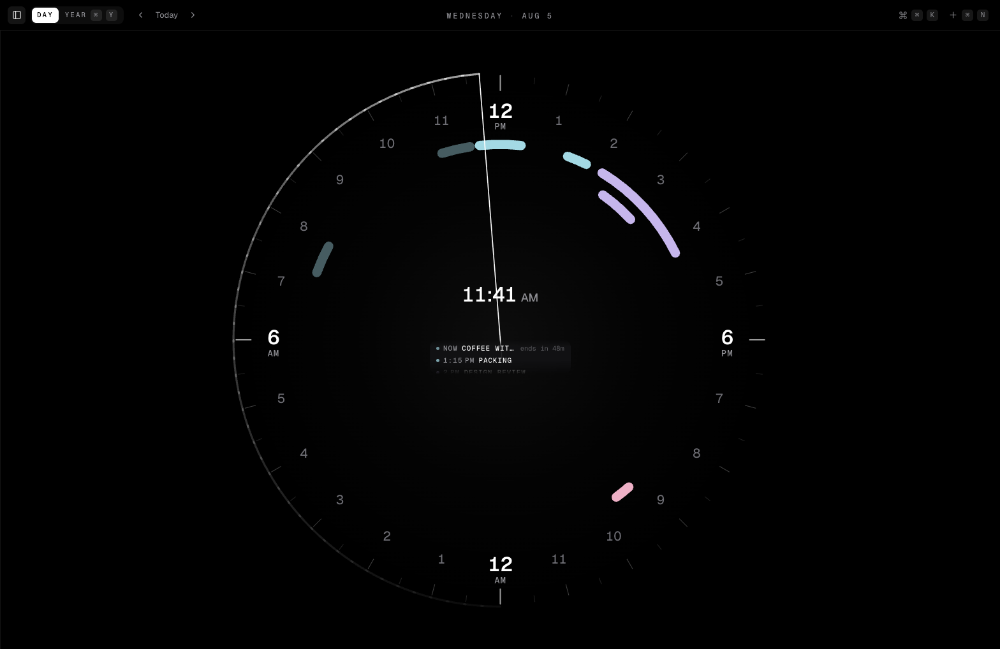

# circal

A calendar whose day is a circle.

A day is one revolution. Events are arcs, the day so far is a ramp of light
around the rim, and the hand is the current minute. A web recreation of
[Radical](https://www.raycast.com) for the browser.

The **Dial** setting (`⌘,`) picks how the face names its hours:

- **12 h** — noon at the top, midnight at the bottom, `12 · 1…11` twice with
  AM/PM captions. 6 AM sits at nine o'clock, 6 PM at three.
- **24 h** — midnight at the top, `00 · 1…23` running clockwise, so `06` is at
  three o'clock, `12` at the bottom and `18` at nine.

Same geometry either way: an event's arc is the same length on both faces, and
switching is a 180° rotation and a relabel. The setting also picks how every
time in the app is written — `1:15 PM` or `13:15`.

Events take their colour from their calendar. Any one event can override that
from the editor's **Color** row: ten digital pastels, or a picker for anything
else.



## The outer rings

Two optional annotations live outside the track, both configured in
**Settings** (`⌘,`):

- **Daylight.** Give circal a latitude and longitude — typed, or taken from
  the browser — and the rim is shaded with the day's actual light: civil
  twilight as a low shoulder, sunrise to sunset ramping with the sun's
  altitude. It is the one thing the circle can show that a grid cannot, and
  its shape visibly turns through the year. Polar day and polar night are
  handled; the band simply fills or vanishes.
- **A second timezone.** Pick a zone and its `00 · 06 · 12 · 18` appear on an
  outer ring, rotated so they sit where those hours fall on _your_ day. The
  caption names the city and how far ahead or behind you it is — `Tokyo +7`,
  not `GMT+9`. There is no second hand, because the instant is the same
  everywhere; only the labels move.

## Your data

Events live in this browser's `localStorage` under `circal.v1`. Nothing is
sent anywhere, which also means nothing is backed up anywhere:

- **Export `.ics`** hands your events to any other calendar.
- **Backup `.json`** is the whole store — events, calendars, settings — and
  restores exactly. Both live in Settings and in `⌘K`.
- **Import** takes either. A `.ics` lands in a calendar of its own so an
  import can always be told apart from what you wrote; a `.json` restores the
  store. Both are one `⌘Z` away from being undone.

**Subscriptions** mirror a public ICS URL — a Google, Apple or Fastmail
"secret address" — as a read-only calendar, pulled on launch and on demand.
Their events draw on the dial and open in the editor, but every field is
locked: it is somebody else's calendar.

Install it (Add to Home Screen, or the browser's install button) and it works
offline. On iOS that is also what stops the seven-day storage eviction from
taking your calendar with it.

## Interaction

|                     |                                                               |
| ------------------- | ------------------------------------------------------------- |
| `⌘K`                | Command palette — search, jump to a date, find free time, run |
| `⌘N`                | New event                                                     |
| `⌘,`                | Settings                                                      |
| `⌘Z` / `⇧⌘Z`        | Undo / redo                                                   |
| `⌘D` / `⌘Y`         | Day view / year view                                          |
| `⌘B`                | Sidebar                                                       |
| `←` `→`             | Previous / next day (year in year view)                       |
| `T`                 | Today                                                         |
| `⌘↵` / `⌘⌫` / `esc` | Save / delete / cancel in the editor                          |

Type a duration into `⌘K` — `45m`, `1h30`, `free 20` — and the palette lists
the gaps in the day that fit it. Picking one opens a draft already filling the
slot.

Drag anywhere on the ring to block out time — the readout in the middle turns
into the range you are drawing. A click on the ring creates an hour. Click an
arc, an agenda row or a day in the year grid to open it.

The selected day is in the URL (`?d=2026-08-05`), so a day is linkable and the
back button works.

## Stack

Astro 7 static shell → one React 19 island → Tailwind v4. Events live in
`localStorage` under `circal.v1` and sync across tabs via the `storage` event.
Deployed as a Cloudflare Worker that serves static assets and exactly one
route: `/api/feed`, a proxy for subscriptions, because no calendar host sends
CORS headers.

```
src/
  lib/
    dial.ts      polar geometry — the 1000-unit viewBox, radii, arc paths
    time.ts      day arithmetic, the app's formatting voice, zone conversion
    events.ts    event model, recurrence expansion, lane packing, free gaps
    sun.ts       solar position — sunrise, sunset, civil twilight
    ics.ts       RFC 5545 serialise and parse
    store.ts     the store (useSyncExternalStore + localStorage)
    feeds.ts     subscription pulls
    backup.ts    export and import
    notify.ts    the toast channel
  components/react/
    App.tsx          shell: which day, which view, which overlay, the URL
    Dial.tsx         the instrument
    CenterPanel.tsx  readout + agenda, pinned to the dial's centre
    TopBar.tsx  Sidebar.tsx  EventEditor.tsx  YearView.tsx
    CommandPalette.tsx  Settings.tsx  Toast.tsx
worker/index.ts  assets + the /api/feed proxy
public/sw.js     offline cache
```

Two overlapping events are pushed onto concentric rings by `packLanes`, so
neither is hidden — that is why the afternoon reads as two arcs, not one.

## Develop

```sh
pnpm install
pnpm dev        # localhost:4321
pnpm dev:worker # build + wrangler dev — the only way to exercise /api/feed
pnpm verify     # format:check + lint + astro check + build
pnpm deploy     # build + wrangler deploy
```
